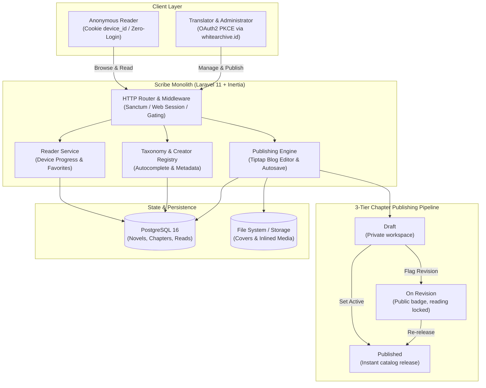

<div align="center">

# Scribe

**Centralized light novel publishing CMS platform for freelance translators and readers.**

[](https://laravel.com)
[](https://inertiajs.com)
[](https://react.dev)
[](https://www.typescriptlang.org)
[](https://www.postgresql.org)
[](https://tailwindcss.com)
[](https://ui.shadcn.com)
[](LICENSE)

[Architecture](#architecture) • [Features](#features) • [Access Control](#role--access-control) • [Tech Stack](#tech-stack) • [Quick Start](#quick-start) • [Operations](#operations--service-lifecycle) • [Troubleshooting](#troubleshooting--self-service) • [Documentation](#documentation)

</div>

---

> **Built for freelance translators and light novel readers.** Scribe provides a centralized, friction-free publishing platform where readers discover and read serialized novels with device-based anonymous tracking, while translators author content with a rich Tiptap editor and publish directly under a unified catalog governed by OAuth2 PKCE SSO.

---

## Architecture



---

## Features

<table>
  <tr>
    <td width="50%" valign="top">
      <h4>Publishing Engine & Editorial Workspace</h4>
      <ul>
        <li><strong>Tiptap Blog Editor</strong>: Rich WYSIWYG text authoring with inline illustration embedding and periodic autosave recovery.</li>
        <li><strong>3-Tier Chapter Lifecycle</strong>: Flexible statuses (<code>draft</code>, <code>on_revision</code>, <code>published</code>) enabling instant publishing without admin gatekeeping.</li>
        <li><strong>Multilingual Metadata</strong>: Original and localized alternative titles with source-to-target language specifications.</li>
        <li><strong>Flexible Serialization</strong>: Support for standalone chapters or volume-grouped hierarchical structures.</li>
        <li><strong>Creator Autocomplete</strong>: Author and illustrator entity deduplication with instantaneous create-if-not-exist handling.</li>
      </ul>
    </td>
    <td width="50%" valign="top">
      <h4>Reader Experience & Governance</h4>
      <ul>
        <li><strong>Zero-Login Device Tracking</strong>: Frictionless browsing, reading history, and favorites backed by anonymized device cookies.</li>
        <li><strong>Unified Central Catalog</strong>: Shared publication index across all translators without fragmented subdomain isolation.</li>
        <li><strong>Delegated SSO Authentication</strong>: Secure OAuth2 PKCE integration with <code>sso.whitearchive.id</code> and 2-stage logout.</li>
        <li><strong>Integrated Ticketing</strong>: Direct communication channels for reader inquiries, chapter requests, and translator bug reports.</li>
        <li><strong>Administrative Moderation</strong>: Global analytics, translator role approvals, content takedown, and taxonomy management.</li>
      </ul>
    </td>
  </tr>
</table>

---

## Role & Access Control

| Role | Authentication Mechanism | Permissions & Scopes |
|---|---|---|
| **Reader** | Anonymous (`device_id` cookie) | Browse catalog, read published chapters, track reading history, bookmark favorites, and submit feedback tickets. |
| **Translator** | SSO OAuth2 PKCE (`translator` role) | Manage owned novels, volumes, and chapters; direct publishing; author revisions; receive and respond to reader tickets. |
| **Administrator** | SSO OAuth2 PKCE (`superadmin` role) | Access platform analytics, grant or revoke translator roles, moderate infringing content, manage global genres and tags. |

> [!NOTE]
> Newly authenticated SSO users initialize with a `pending` status until granted translator privileges by an administrator. User profile data (display name, email, avatar) is managed upstream by `sso.whitearchive.id`.

---

## Tech Stack

| Layer | Technology | Role & Purpose |
|---|---|---|
| **Frontend Framework** | React 19 + Inertia.js 3.x | Reactive client-side rendering seamlessly bridged to Laravel backend routes |
| **Component System** | Tailwind CSS v4 + Shadcn UI | Accessible Radix UI primitives with utility-first responsive styling |
| **Rich Text Editor** | Tiptap Editor v3 | Blog-style editorial experience supporting inline media insertions and autosave |
| **Backend Core** | Laravel 11.x (PHP 8.3+) | Routing, Eloquent ORM, policy-based authorization, and Inertia response delivery |
| **Identity & SSO** | OAuth2 Code + PKCE | Federated single sign-on integration via `sso.whitearchive.id` with 2-stage logout |
| **Database** | PostgreSQL 16 | Relational data persistence with strict relational integrity and indexing |
| **Asset Storage** | Local Disk / S3-compatible | File management for novel covers and user-uploaded chapter illustrations |
| **Infrastructure** | Linux VM / EC2 | Production hosting with Nginx, PHP-FPM, and automated bash deployment scripts |

---

## Quick Start

### Prerequisites

- **PHP**: `^8.3` (with `pdo_pgsql`, `mbstring`, `fileinfo` extensions)
- **Composer**: `^2.2`
- **Node.js**: `^20.0` & **npm**: `^10.0`
- **PostgreSQL**: `^16.0`

### Local Development Setup

```bash
# 1. Clone repository and enter the backend application
git clone https://github.com/whitearchive/scribe.git
cd scribe/backend

# 2. Install backend and frontend dependencies
composer install
npm install

# 3. Initialize environment configuration
cp .env.example .env
php artisan key:generate

# 4. Configure PostgreSQL and SSO credentials in .env, then run migrations
php artisan migrate

# 5. Launch the Vite HMR server and the Laravel development server
npm run dev          # Terminal 1: Vite asset compilation
php artisan serve    # Terminal 2: Application backend at http://localhost:8000
```

### Environment Configuration

Key configuration parameters required in `backend/.env`:

```env
APP_NAME=Scribe
APP_URL=http://localhost:8000

DB_CONNECTION=pgsql
DB_HOST=127.0.0.1
DB_PORT=5432
DB_DATABASE=scribe
DB_USERNAME=postgres
DB_PASSWORD=secret

SSO_CLIENT_ID=your-client-id
SSO_CLIENT_SECRET=your-client-secret
SSO_REDIRECT_URI=http://localhost:8000/auth/callback
SSO_BASE_URL=https://sso.whitearchive.id
```

---

## Operations & Service Lifecycle

The application provides operational automation scripts and Artisan lifecycle commands:

```bash
# First-time server provisioning and deployment wizard
sudo bash scripts/deploy.sh

# Incremental update pipeline (pulls latest code, migrates, rebuilds, optimizes)
bash scripts/update.sh

# Common automation shortcuts via Makefile
make update          # Incremental git pull + build + redeploy
make deploy          # Run deployment wizard for new server environments

# Production caching and route optimization
php artisan optimize

# Clear all compiled views, routes, and application caches
php artisan optimize:clear
```

| Environment | Hostname | Description |
|---|---|---|
| **Staging** | `scribe.suryatmaja.dev` | Active testing and verification deployment |
| **Production** | `scribe.whitearchive.id` | Target production environment under White Archive ecosystem |

---

## Troubleshooting & Self-Service

| Symptom | Probable Cause | Immediate Remediation |
|---|---|---|
| `SQLSTATE[08006] Connection refused` | PostgreSQL service inactive or wrong port | Verify service status (`systemctl status postgresql`) and credentials in `.env`. |
| `SSO PKCE Invalid State` | Session mismatch or blocked cross-domain cookie | Clear session cookies; ensure `APP_URL` and `SSO_REDIRECT_URI` match SSO registration. |
| `Pending translator status` | New SSO account not yet approved | Contact platform administrator to grant `translator` role via admin panel. |
| `Vite manifest not found` | Frontend assets uncompiled in production | Execute `npm run build` or run `bash scripts/update.sh` to generate the Vite manifest. |
| `Chapter locked on revision` | Chapter status explicitly set to `on_revision` | Translators can edit and transition the chapter back to `published` in the dashboard. |
| `CSRF token mismatch` | Expired form session or stale browser tab | Refresh the page or clear local session storage. |

---

## Known Gaps & Limitations

- **SSO User Avatars**: Upstream `sso.whitearchive.id` currently defaults to initials-based placeholders; live avatar synchronization will activate upon SSO provider release.
- **Reader-to-Translator Ticket UI**: Database models and routing are completed in TASK-017; dedicated UI for selecting individual recipient translators is scheduled for P1.
- **Storage Driver**: Initial MVP utilizes local disk storage; automated migration to S3/Cloudflare R2 is planned ahead of public scale.

---

## Documentation

Comprehensive architectural designs, specifications, and workflows are decomposed into modular documentation:

| Document | Description | Target Audience |
|---|---|---|
| [Product Requirements (PRD)](docs/PRD.md) | Platform rationale, user stories, and priority breakdowns | Product Managers & Contributors |
| [Software Requirements (SRS)](docs/SRS.md) | Technical architecture, relational schema, SSO protocol, and route specs | Full-stack Engineers |
| [Project Structure](docs/STRUCTURE.md) | Granular inventory and breakdown of all project folders and files | All Contributors |
| [User & Auth Flows](docs/FLOW.md) | Visual sequence flows for reader tracking and 2-stage SSO authorization | Engineers & Security Auditors |
| [Roadmap & Tasks (TODO)](docs/TODO.md) | Active milestone checklist, ticket registry, and known gaps | Maintainers & Developers |

---

## License

This project is open-sourced software licensed under the [MIT License](LICENSE).
