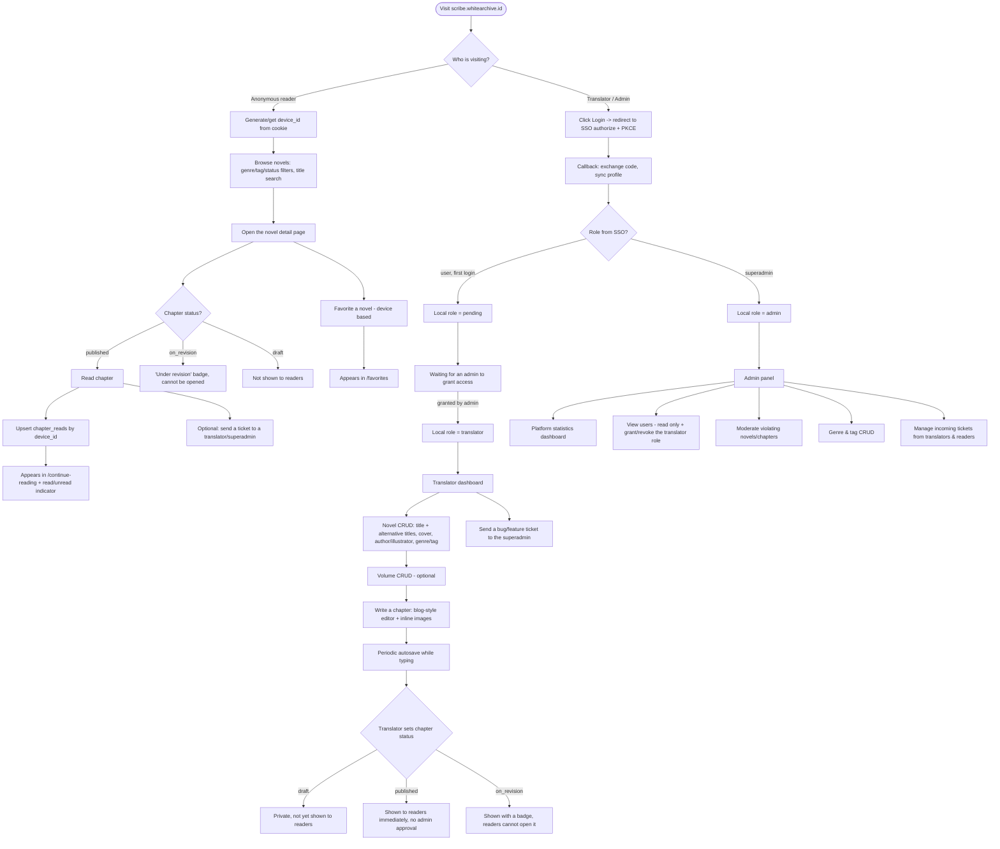
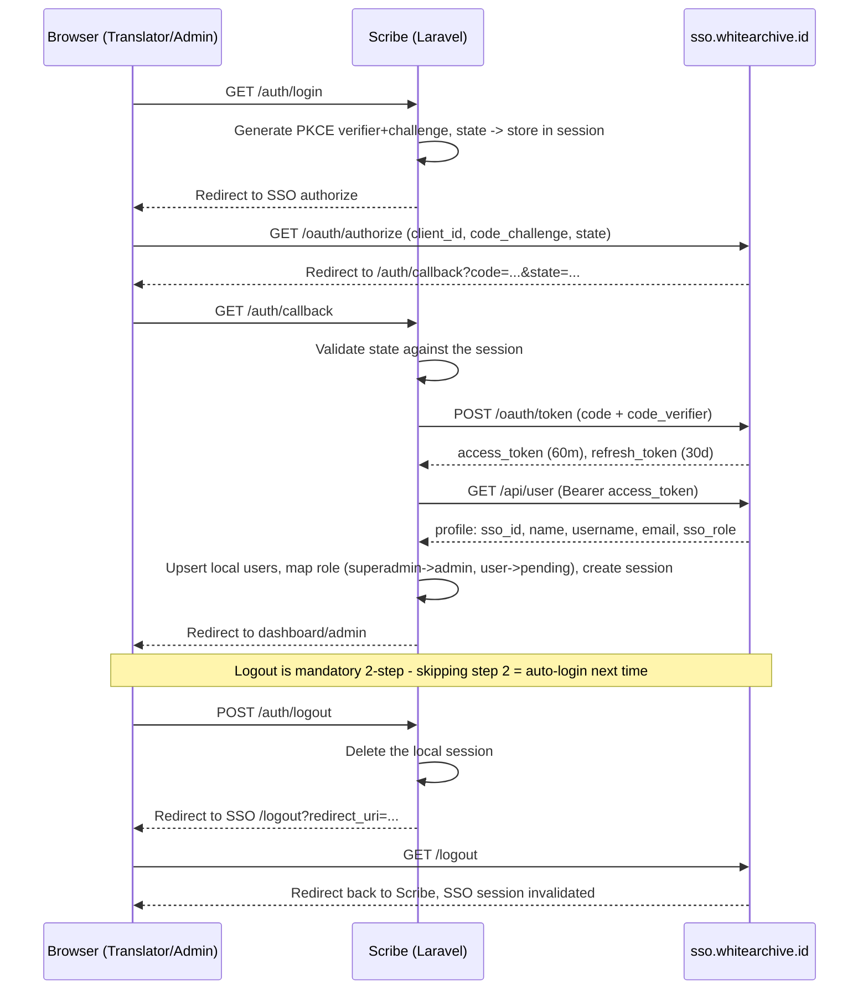

# Scribe — User Flow & Auth Sequence

## Main Flow (Reader, Translator, Admin)

---

## SSO Auth Sequence (Login & 2-Step Logout)

---

## Notes

- Readers never touch the SSO flow: all reader interaction is anonymous, purely based on a `device_id` in a cookie/localStorage.
- There is no approval/publish-request step between "translator sets published" and "chapter shown to readers": the platform is centralized, publishing is direct.
- An `on_revision` chapter stays in the database and stays linked to its novel/volume; it is only hidden from reader access.
